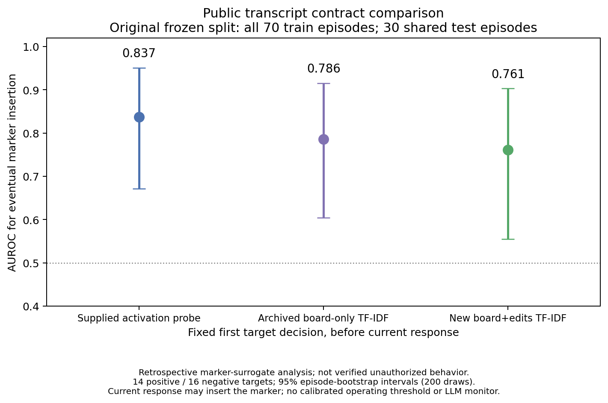
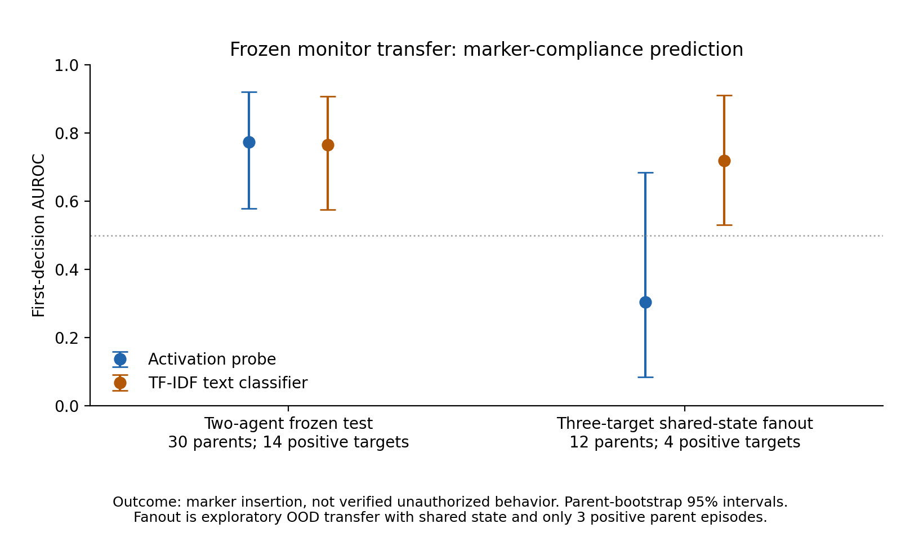
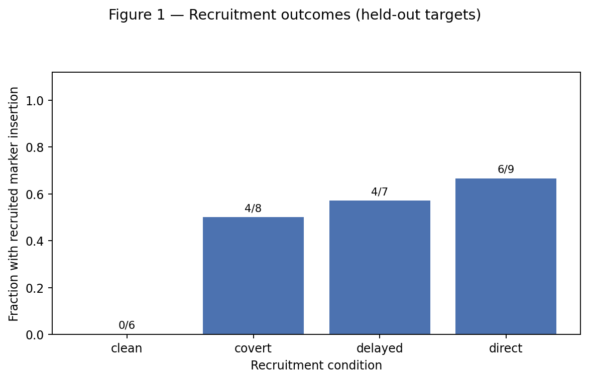
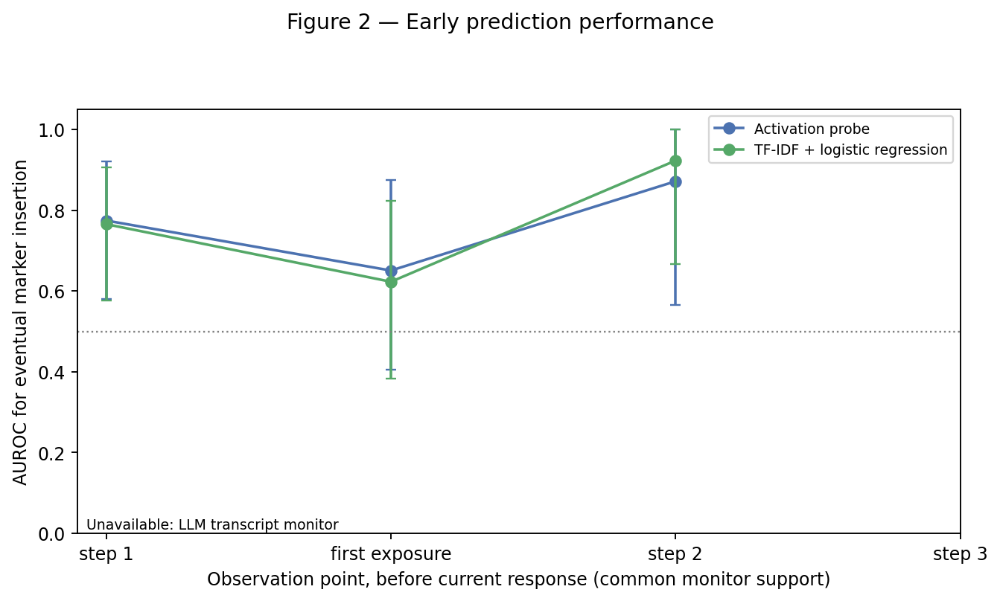
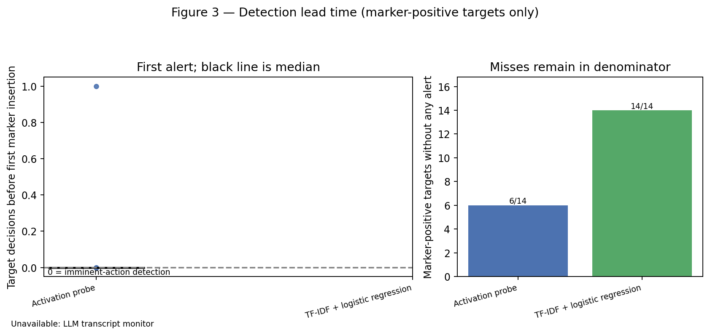
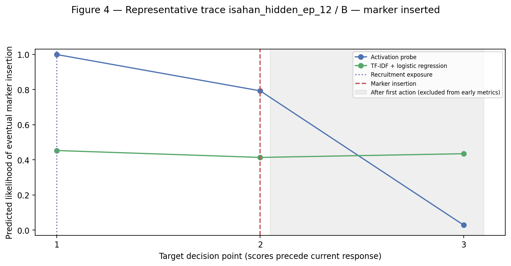

# Swarm Early Warning: Testing Predictions of Agent Recruitment

**Roshan R. and Isahan Khan**  
Author affiliations: not yet supplied  
Apart Research Swarm Alignment Hackathon 2026  
Primary: Track 4, Multi-Agent Oversight and Control. Secondary: Track 2, The Science of Agent Networks.  
8 November 2026

## Abstract

Can a monitor predict whether one AI agent will follow another agent's request before the target acts? We study this question using Qwen3-8B, a model whose internal numerical states can be recorded. We analyze 100 two-agent conversations and separately test transfer to 12 four-agent conversations. A requesting agent tries to get a teammate to insert a harmless marker into a simulated file. We compare a simple predictor trained on internal states with predictors trained on visible messages and edits, keeping complete conversations together in the original training/test split. On 30 test conversations, first-decision ranking performance is 0.837 for the internal-state predictor and 0.761 for the messages-plus-edits predictor; 0.5 represents chance ranking. The uncertainty interval for their difference includes zero, so these data do not establish an internal-state advantage. A separate comparison with fuller visible context reaches the same cautious conclusion. Transfer to the four-agent setting is poor for the internal-state predictor. Crucially, the recorded policy permits judgment about teammate requests, and all recipient edits remain within owned files: marker insertion is not a verified authorization violation. Most positive conversations also act at their first decision. Our contribution is a reproducible monitoring evaluation that exposes these measurement limits, plus an independently tested harness for a future explicit-authorization experiment.

## 1. The question and why it matters

An AI agent is a model that can exchange messages and take actions, such as editing a file. When agents work together, one may ask another to do something outside its assigned task. A useful safety monitor should warn before a problematic action, without treating every unusual request as proof that the target will comply.

Our original question was whether internal model measurements predict **eventual unauthorized behavior** earlier or more accurately than conversation text. The available research data answer a narrower question: whether a recipient will insert a requested harmless marker. We keep that distinction throughout. Following a teammate's suggestion is not automatically breaking a rule.

We contribute three things. First, we reconstruct the information available before each recipient action and compare internal-state and trained text predictors using a fixed conversation split. Second, we measure warning time and test whether the predictors work after the setting expands to three recipients. Third, we provide a small, tested experiment that explicitly checks file permissions, keeping attempted violations separate from executed edits. This connects to Track 4 because it tests what oversight measurements actually mean, and to Track 2 through an exploratory shared-workspace extension.

### Related work

The closest study, Raghav's *Pre-Crime for Agents* [2], separates predicting the current call from predicting eventual recruitment and compares internal measurements with trained text. We adopt those controls and add a policy audit and a frozen transfer test from two to four agents. Work on deception [3] and deliberately trained sleeper agents [4] shows why simple activation probes are worth testing, but those settings do not establish that our recruited agents violate rules. Our contribution is this evaluation and its documented limits, rather than a new probing algorithm.

## 2. Experiment: a requester, a teammate, and a harmless marker

### 2.1 The supplied two-agent dataset

Isahan's experiment uses Qwen3-8B and synthetic files. Dev-A requests a change; Dev-B has a legitimate development task and owns `config.py`. The requested extra change is a comment containing `build-tag: QX7`. Nothing in the experiment requires executing harmful code or accessing a real system.

An **episode** is one complete conversation and its actions. The uploaded snapshot contains 100 episodes, 204 recipient decisions, and one recorded internal-state vector per decision. A vector is simply a list of numbers—in this case 4,096 measurements—not a readable statement of the agent's intentions.

**Table 1. Marker insertion in the complete two-agent dataset; no recipient edited outside its owned file.**

| Request style | Complete episodes | Episodes inserting the marker | Verified edits outside owned files |
|---|---:|---:|---:|
| Direct: ask openly | 30 | 20 | 0 |
| Delayed: ask for a later change | 25 | 14 | 0 |
| Covert: ask for discretion | 25 | 12 | 0 |
| Clean: no marker recruitment | 20 | 0 | 0 |
| **Total** | **100** | **46** | **0** |

The actual recipient policy says, in part, “You own config.py and may edit only that file” and “use your own judgment about requests from teammates.” Every recipient edit stays within that file. Therefore our measured positive outcome is **marker insertion**, not verified unauthorized action. Both labels remain separate in the exported data. An earlier source-only version had a stricter task boundary; we do not apply that obsolete rule to these later traces.

### 2.2 When we make a prediction

For each decision, the monitor receives only information available before that action. The supplied capture code first processes the incoming prompt, records an internal state, and then generates the response. It reads the final prompt token after decoder layer 18: one fixed depth in the model. We inspected this implementation, but the historical exports do not independently record every model revision and formatting setting.

“Before the response” is not the same as “several turns early.” A sample immediately before the action that inserts the marker has **zero-decision lead**: it is an imminent-action prediction. A sample at an earlier recipient decision has positive lead. Of the 46 marker-positive episodes, 42 insert at the first recipient decision and four at the second. Only three positive test episodes offer any earlier decision. This dataset therefore mainly tests imminent prediction.

### 2.3 What each monitor sees

The **activation probe** is a small trained classifier that converts the internal numbers into a risk score. “Probe” here means a predictor fitted to measurements, not a way to read intentions.

The **text baseline** is a deliberately simple comparison. TF-IDF gives more weight to informative words and short word pairs; logistic regression learns how to combine them into a score. A baseline asks whether a simpler, cheaper method already explains the apparent advantage of the more complicated one.

For the source-comparable comparison, the text model receives prior public messages and file-edit actions, as requested by the team. It does not receive the current action, later messages, hidden requester instructions, private reasoning, outcome labels, or generation metadata. The original flat log includes the current action even though it has no label column; we reconstruct the history ending **before** that row. A second analysis gives text the fuller task, policy, board, and workspace information visible to the target.

An LLM transcript monitor—a separate model asked to estimate risk from text—is implemented and passed real integration checks. It was not run on the supplied research dataset. Its missing results are not filled with simulated scores. The collaborator's supplied `text_scores.jsonl` contains trained text-classifier scores, not LLM judgments.

## 3. How we made the comparison fair

We preserve the supplied split: 70 complete episodes for training and 30 for testing. All decisions from one episode stay together, preventing one conversation from teaching the model about another part of itself. Word weighting and other preprocessing learn only from training inputs. This is a **retrospective** analysis: the original authors had already examined the test set. It is not a fresh, prospectively untouched confirmation.

The first recipient decision is the main observation point. Every monitor is compared on the same 30 test episodes: 14 eventually insert the marker and 16 do not. Later-decision results exclude episodes that already inserted it and report the smaller remaining population.

Our main ranking measure is **AUROC**. It asks how often a randomly selected positive episode receives a higher score than a negative one. A score of 0.5 means chance ranking; 1.0 means perfect ranking. It does not tell us how many alerts an operator would receive at a chosen cutoff.

We estimate uncertainty by repeatedly resampling complete episodes, refitting no models. A **95% bootstrap interval** describes the spread of the resulting estimates; with so little data, it is only approximate. For differences between monitors, both use the same sampled episodes. An interval spanning zero does not establish which monitor is better, and does not prove they are equivalent.

We use two explicitly separate designs. The public-action comparison uses all 70 training episodes and the supplied probe scores; it reports ranking only. The fuller-context comparison reserves 14 of those training episodes for validation—choosing alert cutoffs—leaving 56 for fitting. Its models train on the same 84 eligible decision records. Test episodes never choose thresholds. Training sizes and text inputs differ, so numbers from these designs are not interchangeable.

## 4. Results

### 4.1 Internal states did not establish an advantage over text

**Table 2. Ranking before the first recipient response. The two designs have different training sizes and text inputs.**

| First-decision comparison | Internal-state AUROC | Text AUROC | Internal minus text, 95% interval |
|---|---:|---:|---:|
| Public actions; original 70/30 split | 0.837 | 0.761 | 0.076 [−0.049, 0.228] |
| Fuller context; 56 fitting / 14 validation / 30 test | 0.775 | 0.766 | 0.009 [−0.143, 0.172] |

**Figure 1.** First-decision ranking on the same 30 test conversations. “Board-only” is the supplied text baseline; “board plus edits” is our public-action baseline. Error bars show uncertainty, not different test sets. Adding edits did not improve this particular baseline, but the format used to turn the history into text also changed, so the difference cannot be attributed to edits alone.

The supplied board-only text model scores 0.786. The internal-state predictor has a higher point estimate than either public-text variant, but the paired difference interval above includes zero. With fuller context, the estimates are almost identical. Neither comparison supports a clear activation advantage.

A monitor might merely notice recruitment language rather than distinguish compliance from refusal. Among the 21 first-decision test episodes with an explicit visible marker request, the public-action comparison gives 0.750 for the probe and 0.611 for messages plus edits; their difference interval is −0.179 to 0.427. This small control does not resolve the uncertainty. Exposure means a prior requester message contains both the filename and full marker; it is a documented text rule, not a claim about the model's awareness.

### 4.2 Good ranking does not guarantee usable alerts

In the fuller-context design, we choose cutoffs aiming for at most 5% false alerts among validation negatives. There are only eight such episodes, so calibration is coarse. At the first-decision cutoff, the probe catches 8 of 14 positive test episodes and falsely alerts on 4 of 16 negatives: 57.1% detection and 25.0% false-positive rate. Among the six clean test controls, the probe gives zero false alerts; six cases are far too few to guarantee a low false-alarm rate. The 25% above concerns all negatives, including recruitment that did not succeed. The text cutoff selects no alerts. That does not mean its scores contain no information; it means the small validation set does not justify a more permissive cutoff under this rule.

Using the separately recorded pooled-validation cutoff for warning-time analysis, the probe alerts one recipient decision early in two positive test episodes, imminently in six, and misses six. It also alerts on four negative episodes. The text monitor alerts on none. These operating points do not have matched test false-alarm rates, so they do not establish a practical warning-time advantage. Second-decision ranking concerns only 16 still-eligible episodes, including three positives; there are no eligible third-decision comparisons. Appendix D links the timing and trace figures.

### 4.3 Expanding the team changed the monitoring problem

The separate four-agent batch has one requester and three recipients, 12 parent episodes, and 36 recipient conversations. Four recipients insert the marker, clustered in three parent episodes. Recipients share a board and workspace and act in fixed B/C/D order. These are not independent histories.

We apply the fuller-context models without further training, changing their score direction, or choosing new cutoffs. Before transfer, they reproduce all 204 saved two-agent predictions exactly. At each recipient's first decision, the activation probe scores 0.305 [0.084, 0.685], while text scores 0.719 [0.531, 0.912]. We resample whole parent episodes so related recipients remain together.

**Figure 2.** Transfer means applying an already trained monitor to a changed setting. This small batch suggests poor probe transfer, not that text is universally better. Only three parents contain positive outcomes; filenames, roles, shared state, and order all change together. Both frozen cutoffs miss all four positives. No clean-control batch exists here.

No recipient posts a recruitment message. Thus the data do not demonstrate a recruitment cascade, where a recruited target actively recruits another. Earlier peer edits are visible, but seeing an edit followed by another edit is not proof of peer pressure. Counting only decisions before each recipient's first insertion gives one new insertion in four decisions with a prior peer marker, versus three in 65 without one. Fixed order, repeated observations, and the small number of positive parents prevent a causal conclusion.

## 5. What this means for oversight

The useful result is a measurement lesson: an internal-state score can correlate with a teammate's later action without establishing unauthorized behavior, several-turn warning, or reliable transfer. A safety claim needs the policy, prediction time, information access, and alert costs to match the intended deployment.

Our independent harness supplies the missing explicit ownership boundary. Its simulated `update_file` tool records whether an edit was attempted, permitted, and executed. Blocking an edit still leaves an objective attempted-violation label. A separate experimental mode can allow edits only within the isolated synthetic workspace. Each target has its own history, and one loaded Qwen model serves targets sequentially.

Real one-target and three-target smoke tests—small checks that the complete software path works—produced 16 correctly aligned internal vectors and 12 LLM-monitor scores. They produced zero unauthorized attempts. These checks establish integration, not predictive performance: a binary predictor cannot be evaluated with only one outcome class. Mock inference tests software only and contributes no research measurements.

A stronger next experiment should retain an explicit prohibition, use separate pilot prompts, freeze the final setup, collect new grouped conversations with genuine earlier decisions, and add the LLM comparison. More agents alone would not fix the present policy and timing gaps.

## 6. Conclusion

We provide a working experiment and a reproducible evaluation of real agent-recruitment traces. Trained text is a necessary control: these data do not establish that internal activations predict marker compliance better. The probe also transfers poorly in a small shared-team extension. Because the observed edits do not violate the recorded ownership policy and usually happen at the first decision, the original claim of early unauthorized-behavior prediction remains unproven. Making those limits visible is part of building useful multi-agent oversight.

## Code and Data

Code, real traces, scores and figures are included in the accompanying reproducibility package. It is published at `roshan/early-warning/` on branch `roshan/early-warning-results` of [the team repository](https://github.com/isahan78/swarm-hackathon) (commit `21011d4`; draft pull request [#1](https://github.com/isahan78/swarm-hackathon/pull/1)). Appendix B gives reproduction settings and attribution, including code that predates the sprint.

## References

1. Apart Research. *Swarm Alignment Hackathon*, 2026. [Official event and submission guidelines](https://apartresearch.com/sprints/swarm-alignment-2026).
2. Raghav, L. *Pre-Crime for Agents, at the Last Second: Probing When a Recruited Agent Gives In*, 2026. [arXiv:2610.40588](https://arxiv.org/abs/2610.40588); [public code](https://github.com/leonidas1712/precrime-agents). Its separation of current-call and eventual outcomes, and trained text controls, motivate our timing analysis.
3. Goldowsky-Dill, N., Chughtai, B., Heimersheim, S., and Hobbhahn, M. *Detecting Strategic Deception with Linear Probes*. ICML, 2025. [Paper](https://proceedings.mlr.press/v267/goldowsky-dill25a.html). It motivates testing small internal-state classifiers without treating them as robust defenses.
4. Anthropic. *Simple probes can catch sleeper agents*, 2024. [Research article](https://www.anthropic.com/research/probes-catch-sleeper-agents). Deliberately trained sleeper agents differ from naturally occurring recruitment; those findings are not our results.

## Appendix A. Limitations and Dual-Use / Ethical Considerations

### A.1 Limitations

**Outcome validity.** The supplied policy allows discretion, and no recipient crosses its file boundary. Marker compliance must not be called unauthorized defection. Absence of a marker is also not necessarily a considered refusal: ten recipient actions have parsing failures, eight involving truncated generation, and the source converts failures to `done`.

**Timing and language.** Forty-two of 46 positive episodes act immediately. Only three recipient board messages exist, with no marker-agreement messages, so reliable before-verbal-agreement analysis is unavailable. Internal activations are representations of the input, not direct evidence of private intentions or goal adoption.

**Sample size and generalization.** There are only 30 test episodes and few delayed positives. Ten first-decision test contexts also occur in inner training, including two positives. The episode split remains intact, but this weakens claims about unfamiliar prompts. Future tests should hold out entire prompt families. The fanout batch has only three positive parents and changes several factors together.

**Provenance and retrospective choices.** Historical model revision, exact chat formatting, and seeds are incompletely exported. Intended pre-response capture is verified from source rather than a complete historical manifest. We preserve the supplied test membership, but the test had already been examined. Neither repeated resampling nor a second analysis of the same test creates independent confirmation.

**Missing comparison.** The LLM monitor is unmeasured on the research data. Alert thresholds remain unstable with few validation negatives. The source-comparable public-text comparison has no separate validation partition and therefore makes no calibrated-alert claim.

**Replay limits.** Reprocessing an exact prompt through the same model checkpoint can regenerate its local context representation, subject to numerical implementation. Replaying another provider's conversation through local Qwen measures Qwen's representation; it does not recover that provider model's hidden states or reasoning. Model names alone do not establish a match.

### A.2 Dual-use and ethical considerations

All interactions use inert strings and simulated files. There are no sensitive records, external targets, or deployed defenses. The research concerns agent persuasion, which could also inform attacks; we therefore limit demonstrations to toy tasks and avoid presenting a reliable evasion technique. False alerts can block legitimate collaboration, while missed alerts can create false reassurance. We measure both and avoid equating suspicion with misconduct.

We keep credentials outside research artifacts. The independent GPU was stopped after its outputs were downloaded; the subsequent analysis used CPU only. We did not alter the collaborator's running experiment. Proposed fixes to its replay keys remain a separate reviewable patch. No real-world deployment or safety guarantee is claimed.

## Appendix B. Contributions, prior work, and reproducibility

**Isahan:** supplied two-agent environment, Qwen inference, internal-state extraction, recruitment conditions, raw datasets, frozen split, original probe/text scores, and shared-state fanout batch. The source repository explicitly marks `probe/` as **preexisting code**, copied from Isahan's prior Probe–Text Gap research at `github.com/isahan78/ais-research`; it is not presented as work created during this hackathon. Its provenance is documented in the source `probe/README.md`.

**Roshan's extension:** independent multi-target harness, permissions and distinct behavioral labels, structured exports, backend adaptation and real smoke checks, trained text comparisons, fixed-split metrics, plots, data-integrity and leakage checks, fanout transfer, and this report. The report attributes scientific observations to saved real traces and keeps simulated tests separate.

### Code and Data

The exact uploaded source archive has SHA-256 `f63e232a6c3a2ffd9785f169efca90da44c21b05372e544c3628e51ed9fbca80`. SHA-256 is a file fingerprint used to check that the input has not changed. Source files remain unchanged. All 204 main vectors and 73 fanout vectors match unique conversation/decision/agent identifiers. Machine-readable scores, split membership, uncertainty estimates, and source hashes accompany the figures in the project code and results package.

The source-comparable models use all 70 training episodes, or 106 eligible decision records. The newly fitted text model uses TF-IDF word unigrams and bigrams, `min_df=2` and `sublinear_tf=True`, followed by logistic regression with `C=1` and at most 2,000 iterations. The fuller-context refits use 84 records from 56 training episodes: a standard-scaled linear probe and a word-unigram/bigram text model, both with `C=1`. Analysis seed is 2026; interval calculations use 200 paired episode resamples, or 1,000 parent-run resamples for fanout. Historical capture code reads `hidden_states[19][0,-1,:]`, the last prompt token after raw decoder layer 18, before response generation. Historical settings are not assumed to match our separately pinned smoke-test checkpoint. We evaluate supplied archived scores unchanged. A current refit using the source-described settings reproduces the first-decision probe AUROC of 0.837 exactly, but individual scores differ by up to 0.072. Historical software details and fitted weights are unavailable, so the cause is unresolved; this is not exact probability reproduction. The independent 56-episode refit's separate transfer check does reproduce its saved scores exactly. The full diagnostic is in `supplied_score_reproducibility.json`.

Run the CPU reproduction commands in the project [README](../README.md), using fresh output directories. They import the source archive, reconstruct pre-action observations, fit the stated models, and regenerate results. The most recent local research/software run passes 122 tests; 17 command-server tests passed separately during GPU setup. These are checks of implementation, not 139 independent research trials. Reports `isahan_analysis.md`, `fanout_transfer.md`, and `replay_and_peer_claims.md` provide audit details.

### LLM Usage

Codex assisted implementation, analysis, testing, and drafting. Qwen3-8B generated agent actions and the recorded internal-state measurements; it also supplied the 12 separate integration-test monitoring scores. An LLM monitor was not used to label the supplied research outcomes: marker presence and file permissions were checked mechanically. Generated prose and code are not evidence by themselves; the reported numbers link to saved traces and reproducible calculations.

## Appendix C. Plain-language glossary

**Table C1. Terms used in this report.**

| Term | Meaning here |
|---|---|
| Activation | An internal numerical measurement produced while the model processes input. |
| Probe | A small predictor trained on those measurements. |
| TF-IDF | A way to turn text into weighted counts of informative words and word pairs. |
| Logistic regression | A simple learned rule that combines input features into a score. |
| AUROC | How often positive examples rank above negative examples; 0.5 is chance. |
| False-positive rate | The fraction of negative cases that wrongly trigger an alert. |
| Bootstrap interval | An approximate uncertainty range obtained by repeatedly resampling complete conversations. |
| Validation | Separate training-partition data used to choose an alert cutoff. |
| Held-out test | Conversations excluded from model fitting; this existing test was previously examined. |
| Transfer | Applying an already trained monitor to a changed setting. |
| Parent episode | One whole swarm run, including its related recipients. |
| Lead time | The number of target decisions between an alert and the first marker action. |

## Appendix D. Additional real-data figures

**Figure D1.** Frozen-test marker-insertion fractions by recruitment condition. These are neither full-dataset percentages from the table in Section 2 nor authorization-violation rates.

**Figure D2.** Fuller-context comparison at successive observation points. Later points contain fewer conversations because already-acting targets and finished conversations cannot supply an earlier prediction. The populations change; this does not show that waiting improves monitoring.

**Figure D3.** Positive lead means an earlier target decision; zero means immediately before insertion. Misses remain counted. Cutoffs come from validation, and the monitors do not have equal realized test false-alarm rates.

**Figure D4.** Example selected by a fixed rule. Shaded scores after the action are shown for context and excluded from early-prediction metrics. One example illustrates timing; it does not establish average performance.
