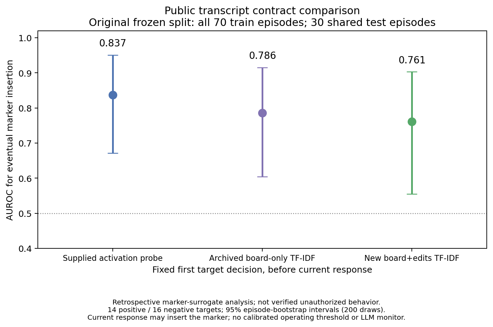

# Comparison using public messages and earlier edits

This retrospective comparison follows the collaborator's requested observation contract: monitors receive earlier public board messages and file-edit actions, with the current target action excluded. It preserves the supplied split of 70 training and 30 test episodes. The outcome is eventual insertion of the inert marker, **not a verified authorization violation**.

## Inputs and fitting

The supplied activation probe and board-only text classifier were trained on all 70 original training episodes. The new board-plus-edits classifier uses those same episodes: 106 eligible target decisions before the first marker insertion, including the decision that inserts it. Text features are word unigrams and bigrams weighted by TF-IDF (how informative a word or word pair is across documents), followed by logistic regression, a simple weighted predictor. Settings are fixed at `min_df=2`, `sublinear_tf=True`, `C=1`, and `max_iter=2000`; no settings or split seeds were searched.

The new input is stable JSON containing only preceding public `message` and `edit` actions with allowlisted sender, step, and action arguments. It excludes the current action, future messages/actions, `done`, system prompts, legitimate task, authorization policy, initial workspace, condition names, episode IDs, marker labels, outcomes, and generation metadata. All 204 decision prefixes are saved separately from labels in `results/isahan_contract_v1/monitor_inputs.jsonl`. Across all prefixes, 131 contain earlier edits and three are empty.

This public-action contract intentionally supplies less context than the target's activation-producing input, which also includes its role and workspace. The separate full-context analysis addresses that difference. Neither text classifier is an LLM monitor.

## Fixed first-decision results

AUROC measures ranking: 0.5 is chance ranking, and 1.0 is perfect ranking. Intervals below resample whole episodes, retaining paired predictions, in 200 fixed-seed bootstrap draws.

| Monitor | AUROC | 95% interval |
|---|---:|---:|
| Supplied activation probe | 0.837 | [0.671, 0.951] |
| Supplied board-only text | 0.786 | [0.605, 0.915] |
| New board-plus-edits text | 0.761 | [0.555, 0.903] |

All three methods use the same 30 first-decision test points: 14 marker-positive and 16 marker-negative episodes. The paired activation-minus-board-plus-edits difference is **0.076 [−0.049, 0.228]**. Its interval includes zero, so this comparison does not establish an activation advantage. It also does not establish equivalence.



In the first-decision exposure subset, 21 episodes remain (13 positive and eight negative). Exposure means a preceding source message contains both `config.py` and the full marker. Probe AUROC is 0.750; board-only text is 0.659; board-plus-edits is 0.611. The paired probe-minus-board-plus-edits difference is 0.139 [−0.179, 0.427].

| Recruitment condition, first decision | Activation | Board-only text | Board-plus-edits text |
|---|---:|---:|---:|
| Overt / direct | 0.944 | 0.694 | 0.583 |
| Latent / delayed | 0.833 | 1.000 | 1.000 |
| Hidden / covert | 0.594 | 0.406 | 0.344 |

Control-only AUROC is undefined because controls contain no positive outcomes. Small condition subsets produce unstable estimates. Adding edits did not improve the score in this run, but serialization also differs from the supplied baseline, so edits alone cannot be identified as the cause.

## Operating points and limitations

No validation episodes were reserved when all 70 training episodes were used. Therefore this comparison reports ranking scores, not calibrated alarm thresholds, accuracy, or false-positive rates. The separate [56/14/30 full-context analysis](isahan_analysis.md) reserves validation data and must not be mixed with these scores: training sizes and input views differ.

The test data had already been examined by the original authors; this is a retrospective reanalysis, not prospectively untouched confirmation. Repeated inputs across episode splits, short traces, incomplete historical model provenance, parsing failures and the permissive target policy limit interpretation. Most positive episodes insert at their first decision, so a pre-response sample usually describes imminent action rather than several-turn warning. No third, LLM transcript-monitor result exists for these episodes.

## Artifacts and reproduction

Machine-readable results, paired scores, label-free monitor inputs, the frozen split, and PNG/SVG figures are in `results/isahan_contract_v1/`. `metadata_correction.json` records an earlier correction to a descriptive input label; no scores, split assignments, or intervals changed in that correction.

From the project directory, use a new output directory:

```bash
.venv/bin/python -m scripts.compare_transcript_contract --input data/isahan_full_v1/analysis.jsonl --archive /path/to/swarm-hackathon --output results/isahan_contract_reproduction
.venv/bin/python -m pytest -q tests/test_transcript_contract.py
```

This repair restores the intended narrative after an accidental documentation overwrite was discovered while preparing the submission. It does not change the underlying analysis or results.
